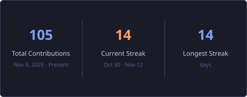

  

  

  
  

  Software Engineer who turns core computer-science concepts into clean, production-quality software — data structures implemented from scratch, algorithms you can <i>watch</i> run, and practical tools that solve everyday problems.

---

### 👨‍💻 About me

- 💼 **Software Engineer** — focused on **Data Structures, Algorithms** and clean, efficient code
- 🔭 Currently building **[AlgoViz](https://github.com/azhruu/AlgoViz)** — an interactive DSA visualizer (sorting, searching, trees, graphs, pathfinding)
- ☕ Implementing core data structures from scratch in **[dsa-java](https://github.com/azhruu/dsa-java)**
- 🌱 Deepening: AVL trees · graph algorithms · shortest paths · system design fundamentals
- 💡 Every project below is complete, tested and runnable — no placeholders

### 🛠️ Tech stack

  

### 📌 Featured projects

<table>
  <tr>
    <td width="50%">
      <h3><a href="https://github.com/azhruu/AlgoViz">📊 AlgoViz</a></h3>
      
Interactive DSA visualizer — sorting, searching, trees, graphs and pathfinding, animated step by step with live metrics. Zero dependencies.

      

        
        
        
      

    </td>
    <td width="50%">
      <h3><a href="https://github.com/azhruu/dsa-java">☕ dsa-java</a></h3>
      
Classic data structures implemented from scratch in Java — linked lists, stacks, queues, trees, heaps, hashing and graphs, each with a runnable demo.

      

        
        
        
      

    </td>
  </tr>
  <tr>
    <td width="50%">
      <h3><a href="https://github.com/azhruu/expense-tracker">💰 expense-tracker</a></h3>
      
Personal finance web app — income &amp; expense tracking, monthly budgets with progress bars and CSV import/export. Runs fully in the browser.

      

        
        
        
      

    </td>
    <td width="50%">
      <h3><a href="https://github.com/azhruu/py-toolkit">🐍 py-toolkit</a></h3>
      
Everyday command-line tools in pure Python — folder organizer, duplicate finder and batch renamer. Standard library only, nothing to install.

      

        
        
        
      

    </td>
  </tr>
  <tr>
    <td width="50%">
      <h3><a href="https://github.com/azhruu/taskflow">🗂️ taskflow</a></h3>
      
A lightweight Kanban board in the browser — add tasks and drag them from To Do to Done, with automatic local saving.

      

        
        
        
      

    </td>
    <td width="50%">
      <h3><a href="https://github.com/azhruu/notevault">🗒️ notevault</a></h3>
      
Markdown notes with a live rendered preview and instant full-text search. Everything stays in the browser.

      

        
        
        
      

    </td>
  </tr>
  <tr>
    <td width="50%">
      <h3><a href="https://github.com/azhruu/shortly">🔗 shortly</a></h3>
      
A tiny URL shortener API in pure Node.js — zero dependencies. Shorten links, redirect with click tracking, JSON persistence.

      

        
        
        
      

    </td>
    <td width="50%">
      <h3><a href="https://github.com/azhruu/dsa-cpp">⚙️ dsa-cpp</a></h3>
      
Classic data structures from scratch in modern C++17 — header-only templates with RAII memory management and runnable demos.

      

        
        
        
      

    </td>
  </tr>
</table>

### 📈 GitHub activity

  

---

<i>Thanks for stopping by — a ⭐ on a project you like means a lot.</i>

